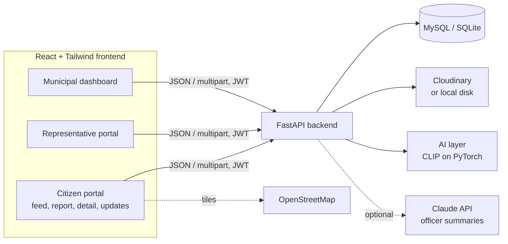
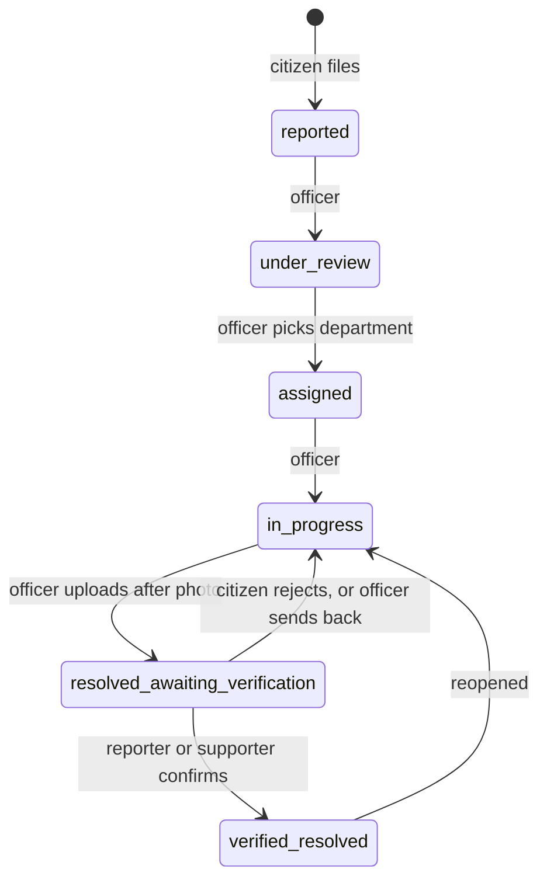

# Architecture

Smart Civic Connect connects citizens, local representatives and municipal staff around one shared record of each civic issue. This document describes how the system is built and why. See also [API.md](API.md), [DATABASE.md](DATABASE.md) and [USER_GUIDE.md](USER_GUIDE.md).

## System overview

All three portals are one React app. Routes and menus depend on the logged-in role. The backend is the only component that touches data, and it enforces permissions on every request, so hiding a button in the UI is never the only protection.

## Code layout

| Path | Responsibility |
|---|---|
| `backend/app/routers/auth.py` | Registration, login, current user |
| `backend/app/routers/complaints.py` | Reporting, feeds, support/like/repost, comments, citizen verification, notifications, AI classify |
| `backend/app/routers/admin.py` | Status workflow, departments, analytics, representative verification, AI insights |
| `backend/app/routers/representative.py` | Development updates, escalation |
| `backend/app/duplicates.py` | GPS plus image similarity for duplicate suggestions |
| `backend/app/ai/` | CLIP model wrapper (classification and embeddings), loaded lazily |
| `backend/app/evidence.py` | Flags suspicious after-repair photos |
| `backend/app/summary.py` | Officer summary (Claude if configured, plain text otherwise) |
| `backend/app/helpers.py` | Status transitions, notifications, image storage, serialisation |
| `backend/app/security.py`, `ratelimit.py` | JWT, password hashing, role checks, rate limiting |
| `frontend/src/pages/` | Feed, Report, Detail, Auth, Notifications, Admin, Representative, Updates |

## Complaint lifecycle

Who can do what:
- **Officers (admin role)** make every transition except `verified_resolved`.
- **Citizens** (the reporter, a supporter, or an admin) are the only ones who can mark a fix as verified. This keeps the final word with the people affected.
- **Representatives** cannot change status. They comment, escalate and publish updates.

Every change is written to `status_history` with a note and the person responsible, and reporter and supporters are notified.

## Duplicate handling

1. The citizen picks a category, location and photo. The backend searches complaints of the same category that are not yet verified resolved, inside a 100 m radius.
2. Each candidate gets a score: location closeness blended with photo similarity. With the AI model, similarity is cosine similarity of CLIP image embeddings. Without it, a perceptual hash (dHash) is used.
3. If a candidate scores high enough, the API answers `409` with the top matches. The citizen can support an existing complaint or file anyway (`force=true`).
4. Supports, likes, comments and reposts always attach to the one canonical complaint.

Two potholes near each other are therefore never merged automatically. The system suggests and a person decides.

## AI layer

One pretrained CLIP model (PyTorch, `transformers`) provides:

| Feature | How | Human in the loop |
|---|---|---|
| Category suggestion | Zero-shot: image compared with text descriptions of each category | Citizen accepts or ignores the suggestion |
| Duplicate suggestion | Embedding cosine similarity plus GPS | Citizen or officer confirms |
| Repair evidence flag | After photo vs original: near-identical, different scene, or still shows the problem | Officer reviews; a flag is not proof |
| Officer summary | Claude API if `ANTHROPIC_API_KEY` is set, else the first lines of the report | Advisory only |

If PyTorch or the model weights are unavailable the backend logs a warning and falls back to hash-based duplicate detection. Nothing else depends on the model being present.

Similarity thresholds (`AI_SIM_LOW`, `AI_SIM_HIGH`, `EVIDENCE_MIN_COS`) are starting values and should be tuned on real photos.

## Security and trust

- Passwords hashed with bcrypt; sessions are signed JWTs (7 days).
- Role checks on every protected endpoint. Representative accounts are unverified until staff approve them, and unverified representatives cannot post updates or escalate.
- Uploads are limited to JPEG, PNG and WebP up to 5 MB.
- Per-IP rate limits on login, registration, reporting and commenting.
- In production the backend refuses to start with the default secret or admin password.
- User text is treated as data when sent to the language model.
- Status history is append-only, which gives an audit trail for the "was it really fixed?" question.

## Testing

| Script (in `backend/`) | Covers |
|---|---|
| `smoke_test.py` | Register, report, duplicate detection, support, full status workflow, verification, notifications |
| `test_ai.py` | AI wiring with a stand-in model: classification, embedding duplicates, evidence flag, insights |
| `test_deploy.py` | Database URL handling, Cloudinary signing and upload, production guard, rate limiting |

## Known limitations

- The AI model has not been evaluated on real complaint photos. Zero-shot classification will make mistakes, which is why every AI output is a suggestion.
- The after-repair check compares images only. It does not verify that the after photo was taken at the same GPS location.
- Reposts are counted and shown on the complaint; they do not yet create a separate item in followers' feeds. A follow system is not built.
- No comment moderation or user reporting yet.
- Rate limiting is in memory per process.
- No database migrations: schema changes need `ALTER TABLE` or a fresh database.
- There are no automated frontend tests and no load testing.
- Notifications are in-app only (no email, SMS or WhatsApp).
