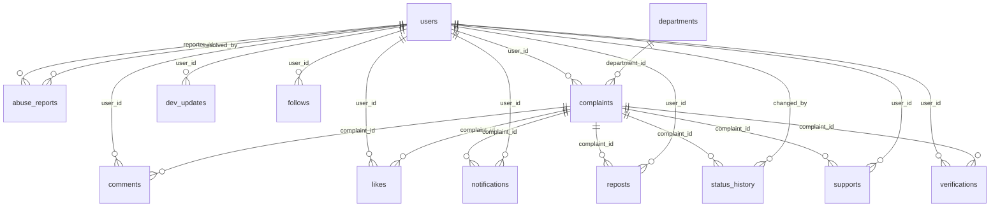

# Database schema

Generated from the SQLAlchemy models by `backend/gen_docs.py`. SQLite for development, MySQL 8 in production.

Design rule: one canonical row in `complaints` per real-world issue. Supports, likes, reposts and comments reference it and never create new official complaints.

## departments

| Column | Type | Notes |
|---|---|---|
| id | INTEGER | primary key |
| name | VARCHAR(100) | unique, required |

Unique together: (name)

## users

| Column | Type | Notes |
|---|---|---|
| id | INTEGER | primary key |
| name | VARCHAR(100) | required |
| email | VARCHAR(150) | unique, required, indexed |
| password_hash | VARCHAR(255) | required |
| role | VARCHAR(20) |  |
| phone | VARCHAR(20) |  |
| ward | VARCHAR(100) |  |
| is_verified | BOOLEAN |  |
| created_at | DATETIME |  |

## abuse_reports

| Column | Type | Notes |
|---|---|---|
| id | INTEGER | primary key |
| reporter_id | INTEGER | references users.id, required |
| target_type | VARCHAR(20) | required |
| target_id | INTEGER | required, indexed |
| reason | VARCHAR(50) | required |
| details | TEXT |  |
| status | VARCHAR(20) |  |
| action_taken | VARCHAR(50) |  |
| resolved_by | INTEGER | references users.id |
| created_at | DATETIME |  |

## complaints

| Column | Type | Notes |
|---|---|---|
| id | INTEGER | primary key |
| user_id | INTEGER | references users.id, required |
| title | VARCHAR(200) | required |
| description | TEXT | required |
| category | VARCHAR(50) | required, indexed |
| latitude | FLOAT | required |
| longitude | FLOAT | required |
| address | VARCHAR(255) |  |
| ward | VARCHAR(100) | indexed |
| image_url | VARCHAR(255) |  |
| image_hash | VARCHAR(32) |  |
| image_embedding | TEXT |  |
| ai_category | VARCHAR(50) |  |
| ai_confidence | FLOAT |  |
| evidence_flag | VARCHAR(255) |  |
| after_image_url | VARCHAR(255) |  |
| status | VARCHAR(40) | indexed |
| department_id | INTEGER | references departments.id |
| is_anonymous | BOOLEAN |  |
| is_hidden | BOOLEAN |  |
| sla_deadline | DATETIME |  |
| is_escalated | BOOLEAN |  |
| escalation_reason | VARCHAR(255) |  |
| priority_score | FLOAT |  |
| created_at | DATETIME |  |
| updated_at | DATETIME |  |

## dev_updates

| Column | Type | Notes |
|---|---|---|
| id | INTEGER | primary key |
| user_id | INTEGER | references users.id, required |
| title | VARCHAR(200) | required |
| body | TEXT | required |
| ward | VARCHAR(100) | indexed |
| before_image_url | VARCHAR(255) |  |
| after_image_url | VARCHAR(255) |  |
| created_at | DATETIME |  |

## follows

| Column | Type | Notes |
|---|---|---|
| id | INTEGER | primary key |
| user_id | INTEGER | references users.id, required, indexed |
| target_type | VARCHAR(30) | required |
| target_id | VARCHAR(100) | required, indexed |
| created_at | DATETIME |  |

Unique together: (user_id, target_type, target_id)

## comments

| Column | Type | Notes |
|---|---|---|
| id | INTEGER | primary key |
| user_id | INTEGER | references users.id, required |
| complaint_id | INTEGER | references complaints.id, required, indexed |
| body | TEXT | required |
| is_hidden | BOOLEAN |  |
| created_at | DATETIME |  |

## likes

| Column | Type | Notes |
|---|---|---|
| id | INTEGER | primary key |
| user_id | INTEGER | references users.id, required |
| complaint_id | INTEGER | references complaints.id, required |
| created_at | DATETIME |  |

Unique together: (user_id, complaint_id)

## notifications

| Column | Type | Notes |
|---|---|---|
| id | INTEGER | primary key |
| user_id | INTEGER | references users.id, required, indexed |
| complaint_id | INTEGER | references complaints.id |
| channel | VARCHAR(20) |  |
| message | VARCHAR(255) | required |
| is_read | BOOLEAN |  |
| created_at | DATETIME |  |

## reposts

| Column | Type | Notes |
|---|---|---|
| id | INTEGER | primary key |
| user_id | INTEGER | references users.id, required |
| complaint_id | INTEGER | references complaints.id, required |
| created_at | DATETIME |  |

Unique together: (user_id, complaint_id)

## status_history

| Column | Type | Notes |
|---|---|---|
| id | INTEGER | primary key |
| complaint_id | INTEGER | references complaints.id, required, indexed |
| status | VARCHAR(40) | required |
| note | TEXT |  |
| changed_by | INTEGER | references users.id |
| created_at | DATETIME |  |

## supports

| Column | Type | Notes |
|---|---|---|
| id | INTEGER | primary key |
| user_id | INTEGER | references users.id, required |
| complaint_id | INTEGER | references complaints.id, required |
| created_at | DATETIME |  |

Unique together: (user_id, complaint_id)

## verifications

| Column | Type | Notes |
|---|---|---|
| id | INTEGER | primary key |
| complaint_id | INTEGER | references complaints.id, required, indexed |
| user_id | INTEGER | references users.id, required |
| accepted | BOOLEAN | required |
| rating | INTEGER |  |
| note | TEXT |  |
| photo_distance_m | FLOAT |  |
| ai_match_passed | BOOLEAN |  |
| created_at | DATETIME |  |
